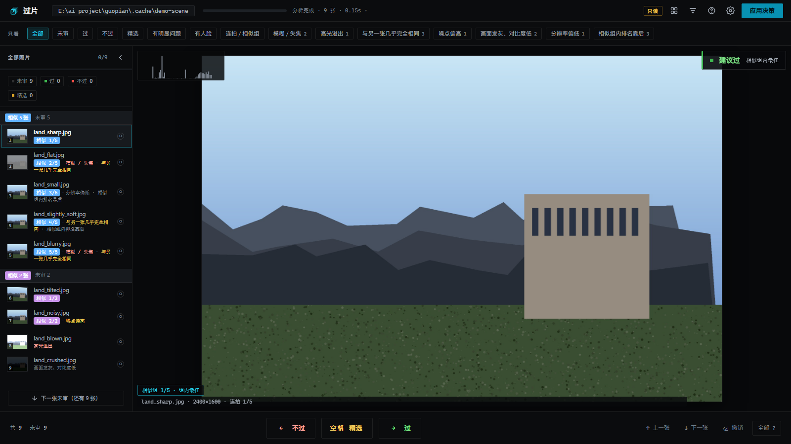
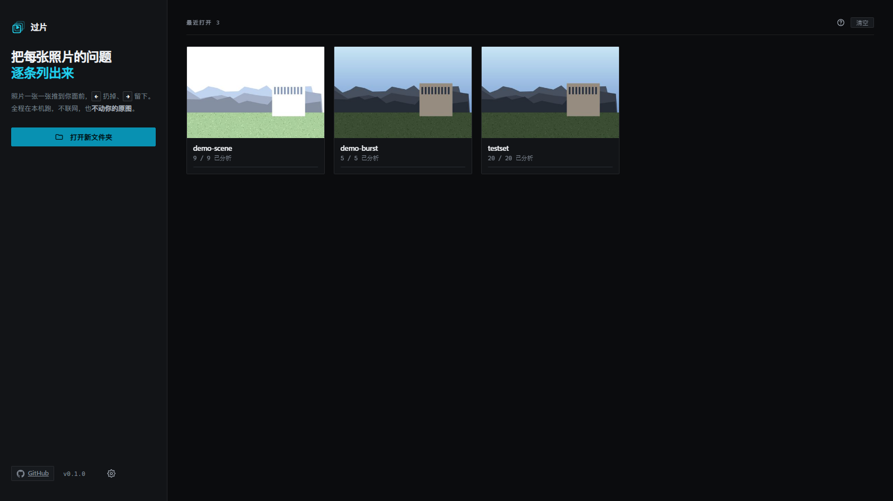

<div align="center">

# 过片 Guopian

**一张一张看照片，说「要」或者「不要」。**

一次旅行拍了几千张，大部分是同一场景的连拍 ——<br>
过片把照片一张张推到你面前，按 <kbd>→</kbd> 留下、按 <kbd>←</kbd> 不要，<br>
最后一次性归档到三个文件夹。

<sub>Windows · macOS · Linux · 全部在本机运行 · 不上传 · 不删任何文件</sub>



</div>

## 它解决什么

翻开一个几千张的文件夹，你不知道从哪看起。一张张双击、判断、重命名、移动，
几百张之后就不想干了。

过片把这件事变成**一个动作**：照片推到你面前，你只回答留不留。

- **不用一张张打开。** 一张接一张，没有文件管理器。
- **会告诉你哪里有问题。** 过曝、失焦、噪点、白平衡偏色、闭眼、张嘴、
  同一场景里哪张最好 —— 逐条列出，并指出是哪张脸、什么程度，不是给个分数。
- **不动你的文件。** 筛选全程只写数据库；归档是最后单独一步，先给你看清单，
  确认了才移动，移动完还能撤回。
- **结果能带走。** 归档后是三个普通文件夹，资源管理器能看，Lightroom 也能导入。

## 它不做什么

这一节比功能列表更能说明它是不是你要的东西。

- **不删照片。** 代码里没有任何删除原片的路径。「不过」只是标记，文件留在原地。
- **不修图。** 不做修脸、换天、超分。它只判断和归类。
- **不上传。** 没有账号、没有云端、没有遥测。首次运行下载模型是唯一一次联网，
  之后可以拔网线用。
- **不做 AI 生成。** 所有判断都是本机的几何测量和统计标定，不是调用大模型。

## 它检查什么

| 类别 | 具体项 |
| --- | --- |
| 曝光 | 高光溢出、暗部死黑、欠曝、过曝、对比度偏低 |
| 清晰度 | 整张不够清晰（取最清楚的那块判断，背景虚化不算）、噪点偏高 |
| 色彩 | 白平衡偏蓝 / 偏黄（相对同一场拍摄的其他照片） |
| 人脸 | 闭眼、眼睛可能闭着、张嘴（可能在说话）、皱眉、视线没看镜头、缺眼神光、人脸贴边、人脸区域不清晰 |
| 连拍 | 相似分组、组内排名靠后、与另一张几乎完全相同 |
| 构图 | 画面倾斜 |

每一项都标出**具体是哪张脸、什么程度**，不是一个笼统的分数。
判断阈值不是硬编码的绝对值，而是按**同一台相机、同一场拍摄**的分布标定出来的 ——
雪地的高光和婚礼的白纱不该用同一把尺子。

## 支持的格式

| 类型 | 扩展名 |
| --- | --- |
| 常见图片 | `.jpg` `.jpeg` `.png` `.webp` `.bmp` `.tif` `.tiff` `.gif` |
| 手机 / 新编码 | `.heic` `.heif` `.hif` `.avif` |
| 相机 RAW | `.dng` `.cr2` `.cr3` `.nef` `.arw` `.raf` `.orf` `.rw2` `.pef` `.srw` |

RAW 和 HEIC 读的是文件里内嵌的预览图，不是全分辨率解码 —— 判断足够，
也意味着它不会为了看一张照片去解 50 MB 的原始数据。

## 怎么用



### 1. 打开一个文件夹

整个目录会被读进来，子文件夹也算。第一次打开会先分析一遍，屏幕上是一条
进度条加实时分类统计；分析完自动进入过图。分析结果缓存在本地，
再打开秒开。

### 2. 一张张过

| 按键 | 作用 |
| --- | --- |
| <kbd>→</kbd> / <kbd>K</kbd> | 要 |
| <kbd>←</kbd> / <kbd>J</kbd> | 不要（只是标记，不删文件） |
| <kbd>空格</kbd> | 精选 —— 要，而且是这批里最好的；再按一次取消 |
| <kbd>↑</kbd> <kbd>↓</kbd> | 上一张 / 下一张（只是翻看，不改状态） |
| <kbd>⌫</kbd> | 撤销上一步 |
| <kbd>I</kbd> | 显示人脸框 |
| <kbd>P</kbd> | 过曝斑马纹 |
| <kbd>Z</kbd> | 按住放大到 100%，松开复原 |
| <kbd>0</kbd> | 复位缩放 |
| <kbd>C</kbd> | 跳到同组下一张 |
| <kbd>G</kbd> | 九宫格总览 |
| <kbd>L</kbd> | 收起 / 展开左侧列表 |
| <kbd>F</kbd> | 全屏 |
| <kbd>?</kbd> | 全部快捷键 |
| <kbd>Esc</kbd> | 关闭浮层 / 退出当前模式 |

按键可以**按住预览**（按住 <kbd>→</kbd>，卡片会先给出预览，松手才生效）；
鼠标拖动卡片也能做决定。放大后用滚轮缩放、按住拖动。

### 3. 一组一起决定

同场景拍了八到十张的时候，不用一张张过。

1. 左侧列表按住 <kbd>Ctrl</kbd> 点几张，或按住 <kbd>Shift</kbd> 点一段
   （<kbd>Shift</kbd> 从**正在看的这张**开始算范围）
2. 右边把它们并排摊开，每张都是清晰图

| 按键 | 作用 |
| --- | --- |
| <kbd>←</kbd> <kbd>→</kbd> <kbd>↑</kbd> <kbd>↓</kbd> | 移动焦点 |
| <kbd>K</kbd> | 焦点这张「留下」 |
| <kbd>S</kbd> | 焦点这张「精选」 |
| <kbd>空格</kbd> | 放大看（再按一次关闭） |
| <kbd>Enter</kbd> | 提交这一批 |
| <kbd>Esc</kbd> | 退出多图 |

也可以直接用鼠标：点图片放大，点「留下 / 精选」。

**提交时的规则**：点过「留下 / 精选」的按点的算，**没点过的一律算不过**。
整批可以用 <kbd>⌫</kbd> 一次撤回。

> 单图和多图是两套独立键位：单图里 <kbd>←</kbd><kbd>→</kbd> 是决定，
> 多图里是移动焦点。多图打开时单图的键位全部失效，不会误伤左侧列表。

### 4. 应用决策

点**应用决策** —— 先看清单，确认后照片分进三个子文件夹：`过` / `不过` / `精选`。
**没审过的留在原地。** 移动完可以整批撤回。

## 你的照片是安全的

- 筛选过程**不写任何文件**，决定只存在数据库里
- 归档要**二次确认**，并且可以整批撤回
- 想彻底不动文件：`python run.py "D:\照片" --read-only`，那种模式下归档会被拒绝
- **代码里没有删除原片的路径**
- 运行时不联网、不上传、不收集任何东西

## 安装

### 从源码运行（目前唯一方式）

需要 Python 3.10+。

```bash
git clone https://github.com/N0tsLabs/guopian.git
cd guopian
python -m venv .venv
```

```bat
:: Windows
.venv\Scripts\pip install -r requirements.txt
.venv\Scripts\python run.py
```

```bash
# macOS / Linux
.venv/bin/pip install -r requirements.txt
.venv/bin/python run.py
```

首次打开项目会自动下载两个本地模型（人脸检测 3.6 MB、照片向量 3.7 MB）。
自动下载失败时手动执行：

```bash
python scripts/fetch_models.py
```

也可以直接从 [models-v1 发布页](../../releases/tag/models-v1) 下载 `photo_embed.onnx`
放进 `models/` 目录。

### 常用参数

```bash
python run.py "D:\照片"           # 直接打开这个文件夹
python run.py --read-only         # 只读：归档会被拒绝
python run.py --no-open           # 只起服务，不弹窗口
python run.py --dev               # 开发模式：改 web/ 自动刷新
python run.py --port 8800         # 换端口
python run.py "D:\照片" --report   # 打印一份指标报表，不启动界面
python run.py --version
```

### 自己打包

```bash
python scripts/build.py           # 产物在 release/
```

没有交叉编译：macOS 的包必须在 macOS 上打，Linux 同理。

## 测试

不需要浏览器的那几个，任何改动后都该跑：

```bash
python evaluation/hygiene.py      # 封装守卫：决策用词、颜色变量、模块依赖图
python evaluation/web_check.py    # JS 引用的 id 是否都在 HTML、切换的 class 是否有样式
node   evaluation/gridlayout_test.mjs
```

需要服务器（先把 run.py 跑起来）：

```bash
python evaluation/full_check.py   # 63 项：接口、数据一致性、删除流程
python evaluation/ui_e2e.py       # 42 项：真实浏览器里逐项操作与断言
```

`ui_e2e.py` 会造一个临时照片库（复制 `evaluation/testset`，没有就现场合成），
再通过一个本地浏览器扩展，在你的浏览器里真实点一遍，跑完删掉临时库 ——
没有这个扩展就跳过它，其余几项都不依赖浏览器。
详见 [evaluation/README.md](evaluation/README.md)。

## 技术栈

Python + Flask 起一个本地服务，前端是**浏览器原生 ES module，零依赖、无构建步骤** ——
改一行 CSS 刷新就生效。图像分析用 OpenCV + MediaPipe，照片向量用 MobileNetV3-Small
（3.7 MB，CPU 上 0.9 ms/张），全部在本机跑。

```
run.py ──► guopian/server.py ──► guopian/pipeline.py ──► catalog.db（每条判定）
                │                      │
                │                      ├─ analyze.py  曝光/清晰度/色彩/人脸
                │                      ├─ group.py    相似分组（向量 + 时间窗）
                │                      └─ apply.py    归档到三个文件夹
                │
                └─► web/（16 个 ES module，浏览器里跑）
```

为什么这么选、踩过哪些坑，写在 [docs/design.md](docs/design.md)。

## 已知限制

- **Windows 上实测过；macOS / Linux 有打包脚本，但没有在真机上长期验证。**
  遇到问题请开 Issue。
- 相似分组依赖照片向量模型；模型缺失时会退回 pHash 分组，效果明显变粗。
- RAW / HEIC 读内嵌预览，极端情况下（预览被裁切、缩略图很小）判断会偏。
- 参考速度：1428 张约 5 分钟（人脸检测是主要开销）。第一次分析无法跳过。
- 只判「这张照片有没有问题」，不判断照片好不好 —— 构图、故事、情绪它不懂。

## 贡献

欢迎 Issue 和 PR。改判定逻辑前请先看 [evaluation/README.md](evaluation/README.md)
最后一节：**合成测试图只能证明代码没崩，证明不了准确率**，真正的阈值来自真实照片的
假阳性 / 假阴性统计。

改动后请保证 `hygiene.py`、`web_check.py`、`full_check.py` 全绿。

## 许可证

[MIT](LICENSE)

## 第三方

- [MediaPipe](https://github.com/google-ai-edge/mediapipe) — 人脸检测（Apache-2.0）
- [Flask](https://flask.palletsprojects.com/) — 本地服务（BSD-3）
- [Pillow](https://python-pillow.org/) · [OpenCV](https://opencv.org/) · [NumPy](https://numpy.org/) · [ONNX Runtime](https://onnxruntime.ai/)（MIT / Apache-2.0）
- 照片向量模型基于 MobileNetV3-Small（Apache-2.0），由本仓库用 ONNX 重新导出
