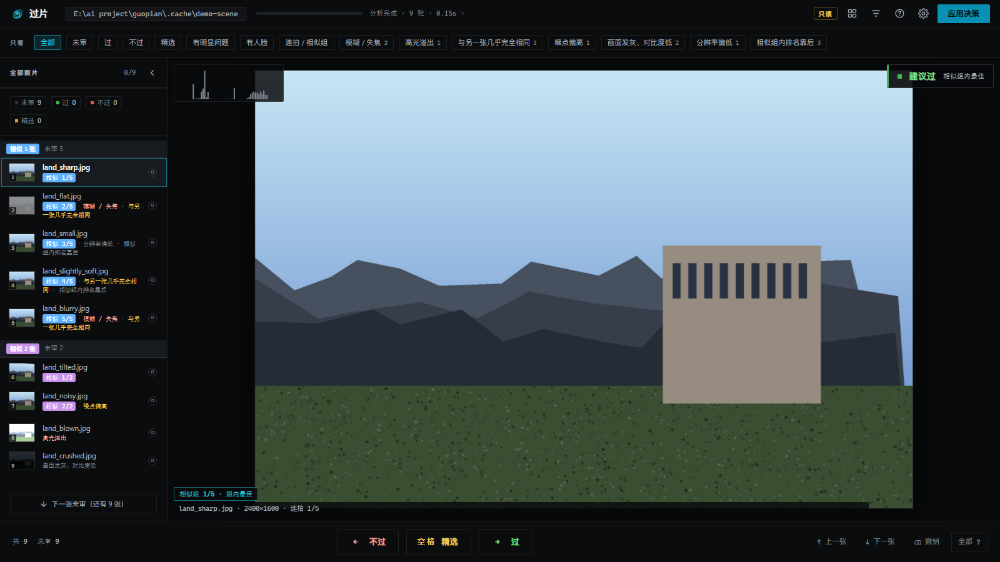

# 过片 Guopian

**几千张照片，一张一张看，只说「要」还是「不要」。**

一次旅行拍了几千张，大半是同一场景的连拍。 
过片把照片推到你面前 —— <kbd>→</kbd> 留下、<kbd>←</kbd> 不要 —— 
最后一次性归档到三个文件夹。

## 它能做什么

**挑片** —— 一个动作，一张照片

- 全屏看，键盘只有两个方向：<kbd>→</kbd> 要、<kbd>←</kbd> 不要；<kbd>空格</kbd> 标「精选」
- **按住先预览，松手才生效** —— 不确认就不会记下来；鼠标拖卡片也能决定
- 按住 <kbd>Z</kbd> 放大到 100% 看对焦，滚轮缩放、拖动平移、双击切换
- 过曝斑马纹 <kbd>P</kbd>、人脸框 <kbd>I</kbd>、直方图、拍摄参数
- 九宫格总览 <kbd>G</kbd>、跳到同组下一张 <kbd>C</kbd>、收起左侧列表 <kbd>L</kbd>

**判断** —— 每一条都指出是哪张脸、什么程度

- **曝光**：高光溢出、暗部死黑、对比度偏低
- **清晰度**：整张失焦（只看最清楚的那块，背景虚化不算）、噪点偏高、压缩痕迹
- **色彩**：白平衡偏蓝 / 偏黄 —— 只跟同一场拍摄的其它照片比，日落本来就该是橙的
- **人脸**：闭眼、眼睛可能闭着、张嘴、眉头压低、缺眼神光、人脸贴边、人脸区域不清晰
- **连拍**：自动分相似组、组内排名、找出几乎完全相同的两张
- **构图**：画面倾斜

**整理** —— 从「看」到「归档」

- 一个场景拍八九张时：<kbd>Ctrl</kbd> 多选，右边并排摊开，<kbd>Enter</kbd> 提交，
  没点过的算不过 —— 一组一次决定
- 按问题筛选：「有明显问题」「连拍 / 相似组」「高光溢出」…… 只看你在意的
- 归档成 `过` / `不过` / `精选` 三个普通文件夹，先给清单再移动，移动完整批可撤回
- 首页记着打开过的项目（可以起别名），分析结果缓存在本地，再打开秒开；
  也能把某个项目的分析数据整个删掉

**格式** —— 不用先导出

- JPG、PNG、WEBP、TIFF、GIF、BMP
- HEIC / HEIF / AVIF（手机直接拷过来）
- 主流 RAW：CR2 / CR3 / NEF / ARW / DNG / RAF / ORF / RW2 / PEF / SRW
- RAW 和 HEIC 读的是文件里的预览图 —— 判断够用，也不会为了看一眼去解 50 MB 原始数据

## 怎么用

1. **打开一个文件夹** —— 整个目录读进来，子文件夹也算；第一次会先分析一遍，
   之后秒开
2. **一张一张过** —— <kbd>→</kbd> / <kbd>←</kbd> / <kbd>空格</kbd>，拿不准就 <kbd>↑</kbd> <kbd>↓</kbd> 翻着看
3. **应用决策** —— 确认清单，照片分进三个文件夹

不知道从哪下手？首页有「**先看看它怎么用**」：拿 12 张演示照片走一遍完整流程，
结束自动删掉，不碰你自己的照片。

其余快捷键按 <kbd>?</kbd>。

## 下载

Windows / macOS / Linux，解压即用，不需要装 Python，也不需要联网。

## 你的照片是安全的

- **不删任何文件。** 代码里没有删除原片的路径，「不过」只是标记
- **筛选不写文件。** 决定只存在数据库里；归档是单独的、二次确认的一步
- **可以完全不碰文件。** `--read-only` 打开时，归档会被直接拒绝
- **不联网、不上传、不收集。** 没有账号、没有云端、没有遥测

## 它不做什么

- 不修图（不修脸、不换天、不超分），只判断和归类
- 不判断照片**好不好** —— 构图、故事、情绪它不懂，只回答「这张有没有问题」
- 不是 AI 生成：所有判断都是本机的几何测量和统计标定

## 第三方

- [MediaPipe](https://github.com/google-ai-edge/mediapipe) — 人脸检测（Apache-2.0）
- [Flask](https://flask.palletsprojects.com/) — 本地服务（BSD-3）
- [Pillow](https://python-pillow.org/) · [OpenCV](https://opencv.org/) · [NumPy](https://numpy.org/) · [ONNX Runtime](https://onnxruntime.ai/)
- 照片向量模型基于 MobileNetV3-Small（Apache-2.0），由本仓库用 ONNX 重新导出

## 许可证

[MIT](LICENSE)
